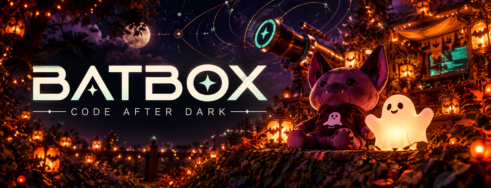

<div align="center">
  

  <h1>Small bat. Big ideas.</h1>
  <p><strong>Your terminal. Your models. Our little corner of the night.</strong></p>
  <p>A C++20 coding companion with streaming conversations, curious Bats, useful Gadgets, and a place for everyone to contribute.</p>

  <p><a href="docs/getting-started.md">Take your first Flight</a> · <a href="CONTRIBUTING.md">Join the Roost</a> · <a href="ROADMAP.md">What’s next</a> · <a href="docs/README.md">Guidebook</a></p>
  <p><strong>LINUX · macOS · WINDOWS</strong> &nbsp; / &nbsp; <a href="LICENSE">MIT</a> &nbsp; / &nbsp; COMMUNITY PROJECT</p>
</div>

---

## Code after dark 🦇

Prompts are poetry, bats are agents.  Natives are Indigenous.

Some of the terminology you find here might be a little different, but that's intentional.

This is a [Digital Disconnections](https://digitaldisconnections.com/) Project so you know privacy, and maintaining
control over your own devices is the top priority.  We don't want your data,
and we never will.

Read our [mission statement: It's Not 1997](https://digitaldisconnections.com/our-story.html).

Like many of you, I used other harnesses for my agents, with different models and
APIs. I wanted a place where the harness stays out of the data business. Batbox
does not collect your data. It never phones home or sends telemetry to us or
third-party analytics services. No usage tracking, advertising trackers, or
automatic crash uploads. **There is no opt-out because there is nothing to opt
out of.**

Batbox requires no account and connects directly to your configured model
endpoint without a Batbox-operated relay. Saved Flights stay on your machine.

The model endpoints, MCP servers, search services, and other helpers you choose
to use receive the inputs needed to carry out your requests. Those services
control their own data practices; Batbox cannot guarantee their logging,
retention, or training policies. Choose services you trust, or run compatible
backends and web services on your own infrastructure.

This project is at a solid start, and I would invite contributions.  AI code is more
than fine, as long as it comes with regression tests.

Bring a project and a little poetry: “Help me understand this code, then fix one
small thing.” Batbox can explore files, make edits, run commands, and keep useful
notes for your next visit. Responses stream into an Indigenous C++/FTXUI terminal
interface from your configured **Anthropic Messages-compatible backend**.

| In the Roost | What you can do |
| :--- | :--- |
| **Compose poetry** | Give your model a destination, context, and room to think. |
| **Send out Bats** | Follow parallel investigations and return to their conversations. |
| **Pick a Gadget** | Read, edit, search, run a shell, and connect MCP servers. |
| **Follow a Mission** | Track work, dependencies, and the next useful step. |
| **Keep your Flight** | Resume conversations and leave project memories for tomorrow. |

The model runs at the endpoint you choose. File and shell Gadgets act on the
machine running Batbox, with approvals controlled by your permission settings.

## Why choose Batbox?

If you want a C++20 terminal companion you can understand, change, and make your
own, pull up a pumpkin. Here is what we are building around:

- **A C++20 heart.** The application and its test suite need no JavaScript,
  Node.js, or Bun runtime. Browser and search helpers remain separate services.
- **Privacy without a switch.** No telemetry collection or third-party analytics
  uploads. There is nothing to opt out of.
- **Your infrastructure, your call.** Use an Anthropic Messages-compatible model
  endpoint, your chosen SearXNG instance, Scrapling, and configurable MCP servers.
  Keep saved Flights local and decide which services receive your work.
- **Let the whole crew fly.** `/permissions` changes the active Flight;
  `--yolo` skips Gadget approval dialogs for it and its launched Bats. Headless
  `--print` runs without approval dialogs by default. Explicit deny rules still
  apply.
- **Room to build together.** AI-written code is welcome with regression tests.
  Platform fixes, accessibility, docs, and artwork all help shape the Roost.
- **A little joy in the terminal.** A bat and ghost greet you, then scroll away
  with the conversation. Poetry, Partners, and Missions give the work some life.

Compared with [OpenCode](https://opencode.ai/), Batbox's clearest distinction is
its C++20 application and focused Messages-compatible backend workflow.
OpenCode offers a broader provider catalog and terminal, desktop, and IDE
interfaces. Batbox is a good fit if this stack, direct backend configuration,
and community direction match the way you want to work.

## A little web magic ✨

**[Scrapling](https://github.com/D4Vinci/Scrapling)** powers browser and extraction
work through its MCP server. **[SearXNG](https://github.com/searxng/searxng)** supplies
search through the instance you configure. Two excellent independent projects;
Batbox connects to them. Give their communities some love, too.

[Connect your web Gadgets →](docs/connectors.md)

## Take a Flight

Run the installer for your platform, connect your backend, then launch Batbox in
your project. The [first Flight guide](docs/getting-started.md) walks through it.

```sh
batbox --cwd /path/to/project
```

On Windows, use `batbox --cwd C:\path\to\project` in PowerShell.
Inside the app, `/help` is your map, `/config` connects your model, and `/bats`
introduces the crew. `/permissions` chooses how freely the Flight can run.
Use `batbox --yolo` to skip Gadget approval dialogs for the whole Flight.
`/monster` has a little surprise.

This is a **community project**. Packaging, desktop integration, and release
acceptance are still being finished. See the [roadmap](ROADMAP.md) before relying
on it for unattended production work.

## Pull up a pumpkin 🎃

Good projects grow through people. You can help with a tiny fix, clearer docs,
terminal accessibility, platform testing, artwork, or a thoughtful bug report.
You do not need to understand the whole codebase to make a useful contribution.

- [Start contributing](CONTRIBUTING.md) — find a small first Mission.
- [Meet the vocabulary](docs/vocabulary.md) — Poetry, Partners, and the rest of the Roost.
- [Read the guidebook](docs/README.md) — configuration and everyday use.
- [See the roadmap](ROADMAP.md) — help shape the next Flight.
- [Keep the Roost welcoming](CODE_OF_CONDUCT.md) — kindness is part of the project.

Batbox is available under the [MIT license](LICENSE). Dependency licenses and
required attributions are preserved in [Third-party notices](THIRD_PARTY_NOTICES.md).

<div align="center"><sub>Made for curious minds, late-night ideas, and the joy of building together.</sub></div>
