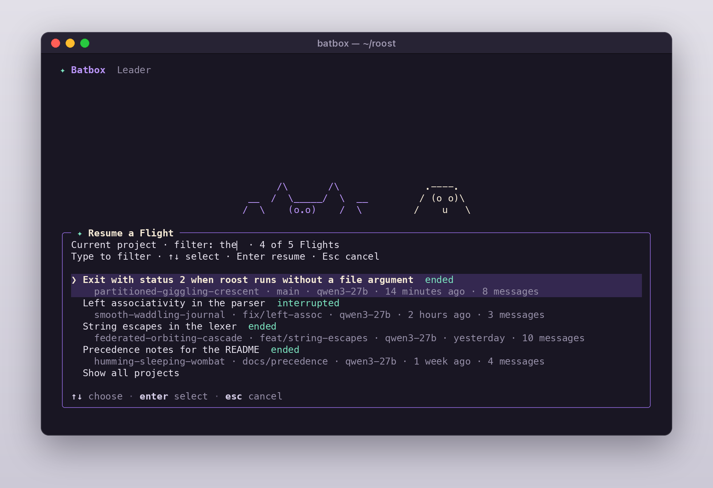

# Everyday Batbox

A good opening piece of poetry gives Batbox a destination and a little context. “Fix this
error” works better with the error text, the command you ran, and what you expected.

## A few good starting points

- “Explain the request flow from this route to the database.”
- “Find the cause of this failing test and make the smallest useful fix.”
- “Review my changes for regressions before I commit.”
- “Split this investigation among bats and show me what each one finds.”

File and shell gadgets run in your selected project. Use `--cwd PATH` at launch
to choose it. Gadget approvals follow your configured permission mode.

On Linux and macOS, Bash commands run in bash or zsh. Batbox uses
`BATBOX_SHELL` when it names a bash or zsh it can run, then your `SHELL` when
that is bash or zsh, then the first bash or zsh it finds on `PATH` or in
`/bin`, `/usr/bin`, `/usr/local/bin` and `/opt/homebrew/bin`. With neither
installed, it uses `/bin/sh`. On Windows, Bash commands run in Git Bash.

## The handy commands

| Command | What it does |
| --- | --- |
| `/help` | Show the live command catalog. |
| `/config` | Manage endpoints, authentication, and request limits. |
| `/permissions` | Choose the current Flight's permission mode. |
| `/model` | Choose a model for upcoming turns. |
| `/effort` | Show or set the model server's reasoning effort. |
| `/context` | See context usage and adjust automatic compaction. |
| `/status` | Check the current flight, model, and usage. |
| `/bats` | Watch every Bat's progress, open its conversation, or message it. |
| `/missions` | See running Bats, background shells, and the Mission board. |
| `/leader` (or `/back`) | Return from a child conversation to the main conversation. |
| `/memory` | Browse, edit, and refresh project and bat memory. |
| `/project` | Show the `.batbox/` recovery files (`Makefile`, `00_project.md`, `10_memory.md`) and whether each loaded. `/project init` creates any that are missing at the project root, and `/project reload` reads them again. |
| `/mcp` | Manage connected gadget servers. |
| `/resume` | Pick a saved Flight; type to filter. `/resume <slug or title>` jumps straight to one. |
| `/continue` | Resume the most recent Flight for this directory and its worktrees. |
| `/rename` | Name the current Flight; with no name, Batbox suggests one. |
| `/compact` | Summarize the current conversation. |
| `/clear` (or `/reset`, `/new`) | Start a new Flight in the same window. The conversation empties, foreground Bats and shells stop, background Bats keep running, and the working directory returns to where you started. The old Flight stays in `/resume`. |
| `/rewind` (or `/checkpoint`) | Pick one of your earlier messages and restore the conversation to just before it, the files Batbox's edit Gadgets changed since then, or both. Changes made through Bash or by hand are not restored. A restored conversation puts the message back in the input to edit. |
| `/monster` | Meet your terminal’s little resident. |
| `/exit` | Close Batbox cleanly. |

## Bring a crew

Use `/effort low`, `/effort medium`, or `/effort high` to send
`output_config.effort` with upcoming Messages requests. `/effort auto` clears
the override and leaves the choice to the server. The selection is saved in
`~/.batbox/settings.json` and can be changed while a turn runs; that turn keeps
its original request. A configured model must support effort for the command to
set a level. This setting does not change Batbox's separate thinking token
budget. `/config` also opens during an active turn.

Open `/bats` (from the leader or from inside a Bat) to see every
Bat with its status, runtime, Gadget count, tokens, current Gadget, and the last
line it wrote. Enter opens a Bat's conversation, `i` or → shows its details
(poetry, recent Gadgets, model, errors), `x` stops it, and `d` dismisses a settled
one. Bats from earlier runs of a resumed Flight are listed too, and opening one
shows its saved transcript.

Inside a Bat's conversation you follow its poetry, reasoning, gadgets, and
replies, and send follow-ups directly. A message to a running Bat shows as queued
until its next Gadget round delivers it; a message to a settled Bat resumes its
existing history. `/bats` switches to another Bat, and `/leader` (or `/back`)
returns to your main conversation.

Ctrl+B from the leader view can background a foreground child. The Active
Missions list under the input box shows running Bats, foreground or background,
with their runtime, Gadget count, and latest line; a sub-Bat sits indented under
the Bat that launched it. Alt+↓ and Alt+↑ step through the Bats, Alt+← (with an
empty input) goes straight home to the main Flight, and Esc goes back one level.
Click a row to open it, or press Ctrl+T to fold the list to one line. While the
list shows Bats launched together, the conversation keeps a single line for
them, such as `2 Bats launched`; when they finish, that row lists each Bat and
its result again. The Bat
you are in is marked with `▸`, and the status row turns into a breadcrumb such as
`Flight › Audit the parser · Alt+↑↓ move · Alt+← home · Ctrl+T list`. See
[Keyboard shortcuts](keyboard.md) for terminal setup. Custom Bat poetry live in
`~/.batbox/agents/` or your project’s `.batbox/agents/`.

A Bat can launch Bats of its own with the Agent Gadget, up to `max_bat_depth`
levels deep (default 3: a Bat, its sub-Bat, and that sub-Bat's sub-Bat; see
[configuration](indigenous-configuration.md#bat-limits)). A sub-Bat runs in its
parent's foreground: the parent waits for its result, and it is not sent to the
background. In the parent's conversation its launch line names the parent, for
example `Check the lexer · Launched by Audit the parser`. A Bat at the deepest
level does not get the Agent Gadget, and its poetry tells it so. The Bat limits
count the whole tree: `--max-subagents` counts every Bat running or waiting,
and `--max-concurrent-subagents` every Bat working. A sub-Bat uses its waiting
parent's concurrent slot; a second sub-Bat launched alongside it needs a free
slot and is refused at once if there is none, since a Bat never waits for a slot
while it holds one. Stopping a Bat (Ctrl+C inside it, or `x` in `/bats`) stops
the Bats it launched, and a Bat that finishes takes any running sub-Bats with
it; they show as stopped. A sub-Bat's transcript is saved under its parent's
(`subagents/agent-<parent>/subagents/`), so resuming the Flight lists it under
its parent again.

Agent progress shows each task's status and latest tool. Foreground agents return
their final results before the leader continues; progress events are display
updates and are excluded from the leader's model requests.

A background Bat's launch result tells the model that the Bat's result will
arrive as a notification. When the model's next step needs that result, it waits
with TaskOutput (`block: true`) instead of launching the Bat again; work that does
not depend on the result comes first. A TaskOutput wait on a Bat lasts up to one
hour by default (30 seconds for a background shell command), and a wait that ends
first reports the Bat as still running, not failed.

## Choose how you fly

Open `/permissions` (or `/permission`), move with the arrow keys, and press Enter
to select a mode. Esc keeps the current choice. The header shows the active mode;
the selection applies to the current Flight and its launched Bats.

| Mode | Behavior |
| --- | --- |
| `default` | Ask when an action needs approval. |
| `acceptEdits` | Approve ordinary file edits automatically. |
| `bypassPermissions` | Skip all Gadget approval dialogs for the Flight and its Bats. |
| `plan` | Keep the Flight in planning mode: Bash commands and file changes are blocked, and the model is told why. |
| `dontAsk` | Deny actions that would need approval. |

Launch directly with `batbox --yolo` or `batbox --dangerously-skip-permissions`.
Both select `bypassPermissions`, just like `--permission-mode bypassPermissions`.
Explicit deny rules continue to apply. To save a startup preference, set
`permissions.defaultMode` in your client configuration.

## Leave a note for next time

Use `/memory` to inspect the actual instruction and memory files. Ask Batbox to
record a useful project convention or a tricky discovery. Its file-memory workflow
keeps topic files and a `MEMORY.md` index; saved notes remain available after
restart and compaction.

Set `VISUAL` or `EDITOR` if you want bat and memory edits to open in your
favorite editor. Project instructions belong in `BATBOX.md` or `.batbox/rules/`.

## Pick up where you left off

`/resume` lists your saved Flights, newest first. Each row shows the Flight's
title, when it was last active, its git branch, the model, roughly how many
messages it holds, and whether it ended cleanly or was interrupted, followed by
its slug in parentheses (for example `dazzling-whistling-tide`). Start typing to
filter by title, slug, branch or project; ↑↓ moves, Enter resumes and Esc
cancels. Long lists show the first 50 matches, so keep typing to narrow them.
**Show all projects** widens the list to every directory; choosing a Flight from
another project switches the workspace to that directory in place.

`/resume <words>` resumes directly when the slug, title or words match a single
Flight, and lists the candidates when several do. `/continue` resumes the most
recent Flight for this directory and its sibling git worktrees, skipping any
transcript that cannot be read.

Titles come from three places, in this order: a name you set with
`/rename <name>`, a short title Batbox generates from your first prompt (or that
`/rename` with no name suggests), and finally the first prompt itself. Title
generation uses the Flight's current model and stays silent if the model server
is unavailable.

At launch:

- `batbox -c` (`--continue`) resumes the most recent Flight here.
- `batbox -r` (`--resume` with no value) opens the picker.
- `batbox --resume dazzling-whistling-tide` resumes by slug, Flight id or title
  words. An ambiguous value lists the matches instead of guessing.

When you leave Batbox it prints `batbox --resume <id>` (or the name you gave
the Flight with `/rename`) so you can come straight back. Rewinding file edits
works after a resume too, including edits made before it.

A resumed Flight keeps the model and permission mode it last used unless you
pass `--model`, `--profile`, `--permission-mode` or `--yolo` at launch.
`bypassPermissions` is never restored on its own; pass `--yolo` again if you
want it.
Fresh installations keep runtime data under `~/.batbox/state/`.
On Windows, the same configuration root lives under `%USERPROFILE%\.batbox`.

## Make the terminal feel like home

Fullscreen is the default; `--inline` selects the inline layout. Scrolling above
live output holds your place. **Go to the action** returns to the latest output.
`NO_COLOR=1` selects neutral colors.
You can keep typing while Batbox works. Press Enter and the message appears at
once at the bottom of the conversation, in the band your sent messages use but
quieter, marked `queued · delivered at the next Gadget round`. The turn keeps
running: the model reads the message after its current Gadgets finish, told
that it arrived while it was working, and can change course before the turn
ends. If the model is writing its final answer instead, the message goes out
as soon as that answer ends, with the same note. Several messages stack in the
order you sent them. When a message is delivered its row turns into an ordinary
message where the model read it, and a resumed Flight shows it there too.
Slash commands and `!` commands typed during a turn are queued the same way and
marked `queued · runs when this turn ends`; they run on their own afterwards.
Pasted images travel with their message. With the input empty, ↑ takes the
newest queued message back into the input to edit; send it again with Enter.

When a request to the model server fails and Batbox retries it, the error shows
with a countdown, `Retrying in 2 seconds… (attempt 1/2)`. While Stop hooks run,
the spinner shows what they report (their `statusMessage`) instead of its verb.

Ask the model to do something later or on a schedule ("every weekday at 9",
"in 20 minutes") and it can use CronCreate; the job runs as a prompt when
Batbox is idle. See the `cron` settings in
[Make your Roost comfortable](indigenous-configuration.md#settings-added-for-scheduling-cleanup-and-the-shell).

Press Esc while a response is running to stop that turn. The status row turns
to `Interrupting…` at once, a request still waiting on the server is dropped
right away, and Batbox adds
“Interrupted the Batbox. What should the model do differently?” to the
transcript. Any messages still queued come back into the input, oldest
first and ahead of anything you had typed, so nothing runs that you did not
confirm and nothing is lost. Edit them or press Enter to continue. At the idle
prompt, Esc retains its input editing behavior.

Esc steps out of the view you are in before it interrupts, and the status row
says which it will do: in the transcript view it closes the transcript, with
the Bats list focused it returns to the input, and in a Bat's view it goes
back one level (`Esc back`). Press Esc again from the main input to stop the
turn. Background Bats keep running either way.

To copy a range longer than the visible screen, press Ctrl+O for the transcript,
then `c` for its copy view. Drag to select; hold the drag at the top or bottom
edge to scroll, or use the wheel while dragging. Releasing copies the entire
selected range, including offscreen text and spaces. Enter or Ctrl+C copies the
selection again in terminals that support OSC 52. Esc returns to the transcript.
The copy view takes a snapshot when opened; close and reopen it to include new
output.

For Terminal.app over SSH, press Ctrl+O then `y` to show the full transcript in
normal terminal scrollback. Select text there and press Command+C, then Return
to resume Batbox. From the copy view, `y` shows just the selected range (or the
full transcript if nothing is selected). The fullscreen layout stays enabled.

For automation, `--print` returns a response and exits. Add `--output-format json`
for JSON, or `--output-format stream-json --verbose` for streaming events. Run
`--help` for the full flag list. Headless Flights select `bypassPermissions` by
default and never wait for an approval dialog, including child Bats. An explicit
`--permission-mode` overrides that default; actions requiring approval in a
restrictive mode return a denial. A policy disabling bypass remains in effect.

To see what Batbox is doing, start it with `--debug` (or `-d`). It copies every
line of the application log for that run to `debug/<Flight id>.txt` in the
state folder (`~/.batbox/state/` by default), and `debug/latest` points at the
newest one. `--debug-file PATH` writes to PATH instead, and `--debug-to-stderr`
writes to stderr, which suits `--print`. `--debug=hooks,checkpoint` keeps only
lines that start with one of those words; `--debug=!checkpoint` drops them.
Without these flags no debug log is written; `native.log` in the state folder
keeps its usual record.
