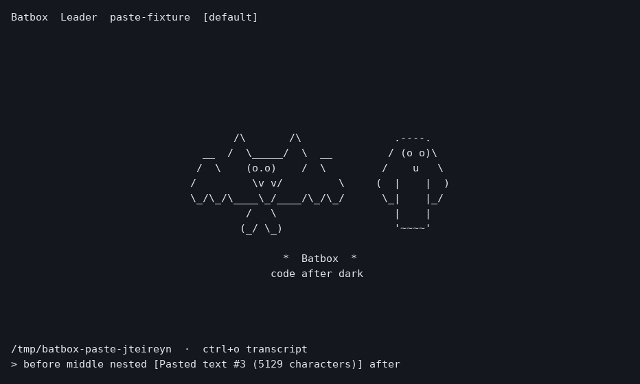

# Your first flight 🦇

You need Batbox for your operating system and a model server. Batbox talks to
**Anthropic Messages** servers natively and to **OpenAI-compatible** servers
through its translator, and it ships with a catalog of 238 providers, from
OpenCode Zen and OpenRouter to a llama.cpp server on your own machine.

## Unpack and get comfortable

On macOS, [Homebrew](#homebrew-on-macos) is the easy road. Otherwise, download
the package for your platform from the
[latest release](https://github.com/Digital-Disconnections-LTD/batbox/releases/latest)
(replace 0.1.2 with the current version):

| Platform | Package |
| --- | --- |
| macOS, Apple silicon | `batbox-0.1.2-macos-arm64.tar.gz` |
| macOS, Intel | `batbox-0.1.2-macos-x86_64.tar.gz` |
| Linux x86_64 | `batbox-0.1.2-linux-x86_64.tar.gz` |
| Windows x86_64 | `batbox-0.1.2-windows-x86_64.zip` |

`SHA256SUMS` on the same page lets you check the download. The macOS packages
use Homebrew's libraries and the Linux package uses your system's; the
[README](../README.md#take-a-flight) has the one-line installs for both.

Keep the package folders together. On Linux and macOS, the executable is
`bin/batbox`; on Windows it is `bin/batbox.exe`. The Windows `bin/` and `etc/`
folders belong next to each other, so the DLLs and certificate bundle stay where
the app expects them.

Extract the archive, change into the folder it creates, and run your installer:

| Platform | Install command |
| --- | --- |
| macOS | `bash gadgets/install-macos.sh` |
| Linux | `bash gadgets/install-linux.sh` |
| Windows PowerShell | `powershell -ExecutionPolicy Bypass -File .\gadgets\install-windows.ps1` |

The installer keeps the package together and puts `batbox` on your user PATH.
Open a new terminal afterwards, then type `batbox` from any project.
No administrator access is needed. Your settings stay in `.batbox` at home.
The same scripts work from a source checkout after its build prerequisites are
installed; they compile Batbox before installing it.

Git, Bash, and ripgrep support the coding gadgets. Web search and fetch are optional:
run `batbox setup web` to add them, as [Web helpers](connectors.md) explains.
The [platform guides](README.md#your-platform-your-terminal) cover runtime details.
A source checkout needs the separate [developer build reference](BUILDING.md).

### Homebrew on macOS

With [Homebrew](https://brew.sh), you can skip the package and install from the
project tap instead:

```sh
brew install digital-disconnections-ltd/batbox/batbox
```

Use the full name. Homebrew 6.0 and later only load formulae from someone else's
tap once you trust them, and installing by full name trusts just this formula.
If you tapped first, or installed before trust arrived and now see "Refusing to
load formula … from untrusted tap", run
`brew trust --formula digital-disconnections-ltd/batbox/batbox` and try again.

Homebrew lowercases the tap owner's name. Add `--HEAD` to build the latest `main`
branch. `brew upgrade batbox` picks up new releases, and `batbox --version` shows
which one you have. If you also used the package installer, remove
`~/.local/bin/batbox` so the Homebrew command is the one on your PATH.

## Connect your model

Start `batbox`. With nothing configured, the provider picker opens by itself:
choose a server it found on your machine or a provider from the catalog, give it
a key (or let Batbox use one from your environment), test the connection and
pick a model. Run `/providers` any time to add another. [Providers](providers.md)
walks through every step, and `batbox providers add <id>` does the same from a
script.

To write the file by hand instead, Batbox reads `native-client.json` from your
home directory’s `.batbox` folder:

| Platform | Configuration file |
| --- | --- |
| Linux and macOS | `~/.batbox/native-client.json` |
| Windows | `%USERPROFILE%\.batbox\native-client.json` |

Create that folder and file, then adapt this example. Replace the URL and model
ID with values from your server operator, and set the token limits to match your
model. The numbers below are examples, not discovered capabilities.

```json
{
  "profile": "main::your-model-id",
  "endpoints": {
    "main": {
      "label": "My model",
      "base_url": "https://model.example.com",
      "messages_path": "/v1/messages",
      "models_path": "/v1/models",
      "auth_header": "x-api-key",
      "api_key_env": "BATBOX_MODEL_KEY",
      "models": ["your-model-id"],
      "context_window": 200000,
      "max_output_tokens": 8192
    }
  },
  "compact_at": 100000
}
```

Use the server origin for `base_url`; `messages_path` supplies `/v1/messages`.
If your server requires Bearer authentication, use `"auth_header": "authorization"`.
Your key can live in an environment variable, so it stays out of project files.

Linux or macOS:

```sh
export BATBOX_MODEL_KEY='your-api-key'
batbox --cwd /path/to/project
```

Windows PowerShell:

```powershell
$env:BATBOX_MODEL_KEY = 'your-api-key'
batbox --cwd C:\path\to\project
```

These variables apply to the current terminal flight. Once inside, `/config`
lets you edit the endpoint and credentials. `/model` discovers available model
IDs or lets you enter one manually. Enable thinking and poetry stashing only when
your backend supports them.

## Say hello, then do something useful

A little wingbeat, a friendly ghost, and you're home. In the full-screen terminal,
the pair greets you on opening, settles near the upper third, and scrolls along
with your conversation. Scroll back to the top whenever you want to say hello.

Start small: “Tell me what this project does. Don’t edit anything yet.”
Then try: “Find the code responsible for settings and explain how it works.”

Use `/permissions` to choose your permission mode. `/help` lists the commands available in
your running version. `/context` shows your conversation’s context budget,
`/status` shows the current model and usage, and `/exit` closes the app.

Large or multiline pastes appear as a compact item such as
`[Pasted text #1 (4481 characters)]`. Left and Right move across the whole
item; Backspace after it or Delete before it removes the whole paste. You can
type instructions before and after it. On Enter, Batbox sends the full text
to your model, so the compact display does not reduce model token usage.



Want a quick answer from a script? Use `--print` (or `-p`):

```sh
batbox --print "Explain this project's entry point in three sentences."
git diff | batbox -p "Review this change."
```

Piped input is added to the prompt, or used on its own when `-p` has no text.
Headless `--print` runs gadgets automatically by default, including child Bats.
It never waits for an approval dialog. An explicit `--permission-mode` can choose
a more restrictive mode for a particular run. The same flags work in PowerShell.

To open the terminal with a first prompt already sent, use `--prompt`:

```sh
batbox --prompt "Tell me what this project does. Don't edit anything yet."
```

A prompt on the command line always goes through `-p` or `--prompt`. The first
word after `batbox` is otherwise a command: `setup web`, `doctor`, `providers`,
`poetry`, `help` or `version`. Anything else, such as `batbox update`, prints the usage
and exits without contacting your model.

## Customising the system prompt

Batbox's system prompt (its poetry) is plain Markdown. To make it your own:

```sh
batbox poetry export   # copies the built-in prompt to ~/.batbox/system.md
batbox poetry          # shows the prompt in use and its source
```

Edit `~/.batbox/system.md`; the next request uses it, no restart needed.
`/poetry` shows the source and a preview inside the app, and `batbox doctor`
reports it. The per-Flight parts drop in with placeholders:
`{{section:using_your_tools}}`, `{{section:session_guidance}}`,
`{{section:memory}}`, `{{section:env_info_simple}}`, `{{section:language}}`,
`{{section:output_style}}`, `{{section:mcp_instructions}}`,
`{{section:scratchpad}}`, `{{section:frc}}`,
`{{section:summarize_tool_results}}`, or `{{sections}}` for all the rest.
Anything you leave out is appended at the end. Delete or empty the file to go
back to the built-in prompt. [Make your Roost comfortable](indigenous-configuration.md#customising-the-system-prompt)
has the details.

## If takeoff is bumpy

| Symptom | Check |
| --- | --- |
| Authentication fails | The key, `auth_header`, and environment variable in the terminal launching Batbox. |
| The server reports an unknown model | Its exact wire model ID; refresh `/model` or enter it manually. |
| The request returns 404 | The combination of `base_url` and `messages_path`. |
| A library or DLL is missing | Your platform guide and the package’s dependency inventory. |
| Web search or fetch is unavailable | `/connectors` or `batbox doctor`, then `batbox setup web`. |
| Configuration will not load | Valid JSON: commas between entries, with no trailing commas. |

Next stop: [Everyday Batbox](everyday-use.md).
